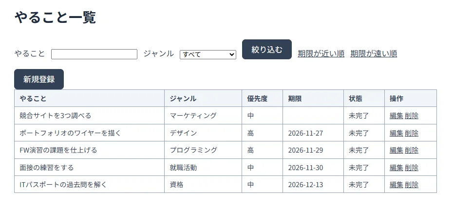
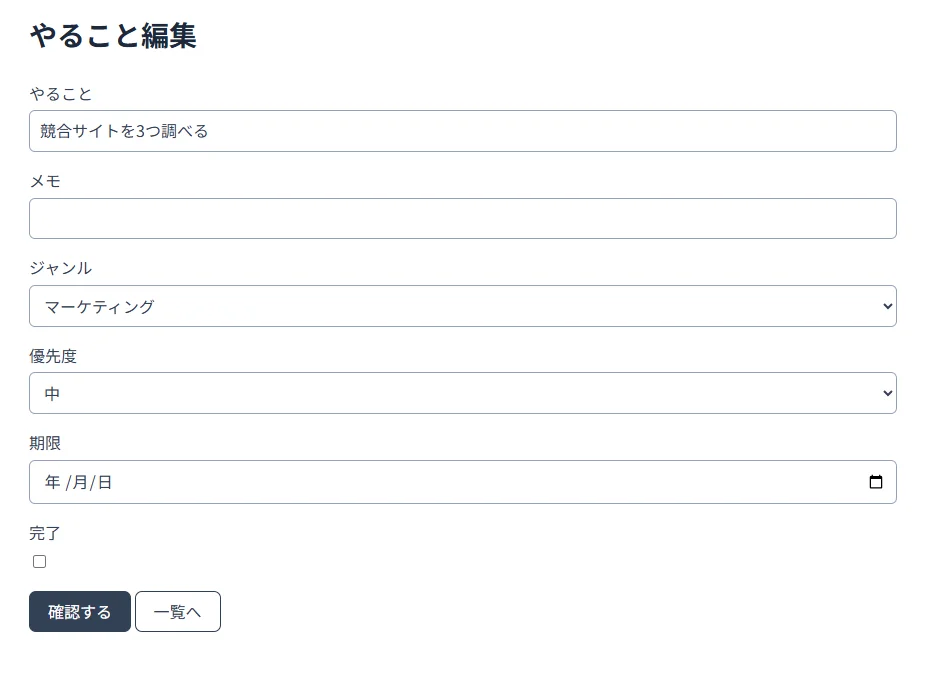

# ToDo管理Webアプリ（fw-todo）

Java / Spring Boot / MySQLを使用して制作している、個人向けのToDo管理Webアプリケーションです。
職業訓練で学んだWebアプリケーション開発、データベース連携、設計、Dockerによる開発環境構築を実践するために作成しています。

> **開発状況**：学習・開発中のプロジェクトです。コードに実装されている内容を中心に紹介しています。動作確認や自動テストは今後も拡充する予定です。

## 画面イメージ

実際に起動したアプリの画面です。

### ToDo一覧



### ToDo編集



## 主な機能

| 機能 | 内容 |
| --- | --- |
| ToDo一覧 | 登録したタスクのタイトル、ジャンル、優先度、期限、完了状態を表示 |
| 新規登録 | タイトル・メモ・ジャンル・優先度・期限を入力し、確認画面を経由して登録 |
| 編集 | 既存のToDoを編集し、完了状態も変更可能 |
| 削除 | 削除確認画面を表示してから削除 |
| 検索・絞り込み | タイトルの部分一致検索、ジャンルによる絞り込み |
| 並び替え | 期限の近い順・遠い順に並び替え |

- 登録・編集の確認画面への遷移時に入力検証を行います。
- 登録・編集・削除の実行時には、操作種別と対象IDをログに記録します。
- このアプリは1人での利用を想定しており、ログイン機能は設けていません。

## 使用技術

| 区分 | 技術 |
| --- | --- |
| 言語 | Java 21 / HTML / CSS / SQL |
| バックエンド | Spring Boot 4.0.9 / Spring MVC |
| テンプレートエンジン | Thymeleaf |
| データアクセス | MyBatis 4.0.0 |
| データベース | MySQL 8.0 |
| ビルド | Maven |
| 開発・実行環境 | Docker / Docker Compose |

※バージョンはリポジトリ内の設定ファイルに記載されたものです。

## アプリケーションの構成

```text
ブラウザ
  ├─ HTML / CSS（Thymeleaf）
  └─ HTTPリクエスト
       ↓
HomeController
       ↓
TodoService
       ↓
TodoMapper（MyBatis）
       ↓
TodoMapper.xml（SQL）
       ↓
MySQL（todosテーブル）
```

| ファイル・ディレクトリ | 役割 |
| --- | --- |
| `src/main/java/com/example/todoapp/HomeController.java` | リクエストを受け付け、画面への遷移や入力を処理 |
| `src/main/java/com/example/todoapp/TodoService.java` | Controllerとデータアクセス層の間で処理を仲介 |
| `src/main/java/com/example/todoapp/TodoMapper.java` | データベース操作のインターフェース |
| `src/main/resources/mapper/TodoMapper.xml` | 検索・登録・更新・削除に用いるSQL |
| `src/main/java/com/example/todoapp/Todo.java` | ToDoデータのモデルと入力検証の定義 |
| `src/main/resources/templates/` | Thymeleafによる画面テンプレート |
| `initdb/01_create_table.sql` | 初期テーブル定義 |

## 起動方法（Docker Compose）

### 前提

- Gitがインストールされていること
- DockerおよびDocker Composeが利用できること
- ホスト側のポート`8080`と`3307`が他のアプリと競合していないこと

### 手順

1. リポジトリを取得します。

   ```bash
   git clone https://github.com/dosay-lab/fw-todo.git
   cd fw-todo
   ```

2. 環境変数ファイルを作成します。

   ```bash
   cp .env.example .env
   ```

   Windows PowerShellでは、代わりに `Copy-Item .env.example .env` を使用します。
   作成した `.env` に、ローカル開発用のパスワードを設定してください。

   ```dotenv
   MYSQL_ROOT_PASSWORD=ここに任意のパスワードを設定
   ```

   `.env` は `.gitignore` に含まれているため、GitHubにはコミットしないでください。

3. コンテナをビルドして起動します。

   ```bash
   docker compose up --build -d
   ```

4. ブラウザで以下にアクセスします。

   **http://localhost:8080/todos**

5. 終了するときは次のコマンドを使用します。

   ```bash
   docker compose down
   ```

**ポート構成**：Webアプリはホスト側の`8080`、MySQLはホスト側の`3307`を使用します（MySQLコンテナ内は`3306`）。

## 設計・開発資料

- [配布仕様書](./handout_app_spec.md)
- [要件定義書](./requirements.md)
- [画面設計書](./screen-design.md)
- [DB設計書](./db-design.md)
- [初期化SQL](./initdb/01_create_table.sql)

職業訓練で配布された仕様書を基に、要件整理から画面・DB設計、実装まで段階的に取り組んでいます。
要件整理・設計・実装の学習過程では、Codexなどの生成AIも補助的に利用しています。作成された内容を仕様書と照合し、コードの役割を理解しながら開発しています。

## 学習で意識していること

- **役割分担**：Controller、Service、Mapperを分離して、Web画面処理とDBアクセスを整理する。
- **SQLの分離**：MyBatisのMapper XMLにSQLを記述し、データアクセスを管理する。
- **入力と表示の分離**：登録・編集では入力画面と確認画面を用意する。
- **開発環境の再現性**：Docker ComposeでアプリとMySQLを起動できる構成にする。
- **設計と実装の対応**：配布仕様書から作成した要件定義書・設計書とコードを見比べる。

## 今後の改善予定

- 保存処理そのものでも入力値を検証し、確認画面を経由しないリクエストへの対策を強化する。
- 検索・登録・更新・削除などの自動テストを追加する（現状のテストはアプリケーションコンテキスト起動確認が中心）。
- 画面のスクリーンショットと実際の動作確認結果を掲載する。
- DB接続用ユーザーや認証情報の扱いなど、運用を想定した設定を見直す。

## 補足

本リポジトリは職業訓練における学習用の制作物であり、一般公開サービスとしての運用を目的としたものではありません。
